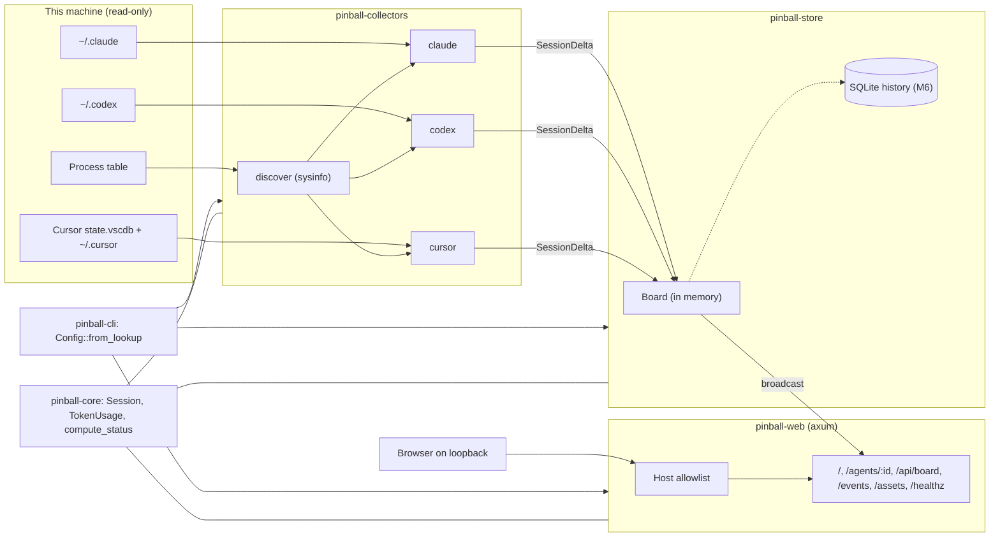
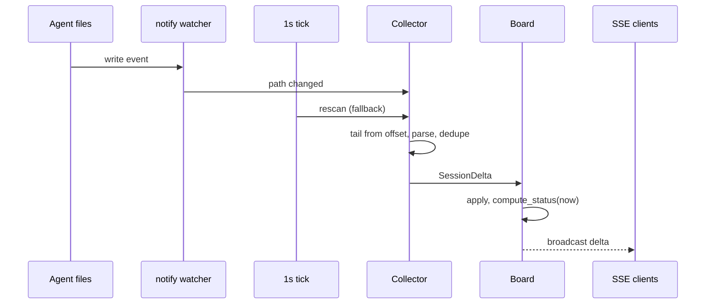

# agent-pinball system design

Status: draft for the first implementation milestones. The UI is specified in
[docs/design/COMPONENTS.md](design/COMPONENTS.md), with a static prototype at
[docs/design/prototype/index.html](design/prototype/index.html). The decisions
behind this document are recorded in [docs/adr/](adr/).

The engineering rules (lint, tests, Docker) live in
[STANDARDS.md](../STANDARDS.md) and [AGENTS.md](../AGENTS.md); this document
does not repeat them.

---

## 1. Goal and non-goals

**Goal.** Show, on one local web page, every Codex, Cursor and Claude coding
agent session running on this machine: which project it works on, which model
it uses, how full its context window is, how many tokens it has consumed so far,
and whether it is working, waiting, stuck or broken.

**Non-goals.**

- **Controlling agents.** The panel never starts, stops, signals, prompts or
  edits an agent, and never writes to an agent's files (AGENTS.md invariant 4,
  [ADR 0001](adr/0001-monitor-only-read-only-panel.md)). The one exception is
  `agent-pinball setup`, run by the user in a terminal, which adds or removes
  agent-pinball's own hook entries ([ADR 0006](adr/0006-setup-writes-agent-hooks-from-the-cli-only.md), §14).
- **Cost accounting.** Tokens are shown as raw counts. No prices, no currency.
- **Multiple users or machines.** One user, one workstation, a loopback bind
  (invariant 1). No authentication, so no remote access.
- **Reading conversations.** v1 shows no prompt or response text (§9).

---

## 2. Vocabulary

| Term | Meaning |
|---|---|
| **Agent host process** | An OS process running an agent: `claude`, `codex`, `codex app-server`, the Cursor app, `cursor-agent`. One host may run several sessions (Codex app-server, Cursor). |
| **Session** | One conversation with an agent: a Claude transcript, a Codex rollout, a Cursor composer. **The unit of display**: one ball on the playfield is one session. Subagent sessions attach to their parent. |
| **Turn** | One user request and everything the agent does to answer it, until the agent hands control back. A turn contains one or more model calls. |
| **Context** | Tokens currently in the model's window over the model's limit, from the last model call: `used / limit`. It rises with each call and drops after compaction. |
| **Coins** | Raw cumulative tokens across every model call in the session (input, output and cache traffic). Named after the coins a pinball machine takes. No price is attached. |

**Why more context means more coins.** A model call resends the whole
context. A session whose context sits at 150k tokens spends roughly 150k
coins on every call, however short the new message is. Context grows by about
the same amount each turn, so per-call coins grow linearly and cumulative
coins grow roughly quadratically with the number of turns. Compaction resets
the slope, which is why the panel marks compaction events. (Cache reads are
cheaper for the provider, but they are still tokens moved; the panel counts
them and shows the breakdown in the detail view.)

---

## 3. Architecture

### Crate map

**`pinball-core`** (exists; grows in M1). Pure domain types, no I/O.

- `AgentKind` (exists).
- `Agent`: kind plus host process info (PID, start time, executable name,
  working directory). Never argv (§5).
- `SessionId`: provider-qualified (`claude:<uuid>`, `codex:<uuid>`,
  `cursor:<composerId>`), parsed once, used as the URL key.
- `Session`: id, kind, parent id for subagents, project directory, model,
  `ContextGauge`, cumulative `TokenUsage`, timestamps of the last write and the
  last turn boundary, open-turn flag, last error, a `Sanitized` title.
- `TokenUsage { input, output, cache_read, cache_write }`, **normalized** so
  `input` excludes cache traffic for every provider. Codex reports
  `input_tokens` with cached tokens already included (`cached_input_tokens` is
  a subset), so its collector subtracts them; Claude reports
  `input_tokens` without cache, so it is taken as is. `total()` sums the four.
- `ContextGauge { used: u64, limit: Option<u64> }`. `limit` is `None` when the
  provider does not report it and no rule can infer it; the UI then shows the
  raw count without a percentage.
- `Status` (§6) and a pure `compute_status(&Session, now) -> Status`. The clock
  is a parameter, never `SystemTime::now()`.
- `Sanitized<T>`, constructible only through `sanitize()` (§9).

**`pinball-collectors`** (new in M2). One module per provider plus discovery.

- `discover`: one process scan per tick (sysinfo), §5.
- `claude`, `codex`, `cursor`: each reads from a root injected by config and
  turns provider records into `SessionDelta` values.
- JSONL files are tailed from a stored byte offset per file; only complete
  lines (ending in `\n`) are consumed, so a partially written line is read on
  the next pass. A file that shrank or whose inode changed is re-read from 0.
- Bounded: a line over 1 MiB is skipped with a counter, a first read of a
  large file starts from its last 8 MiB plus a search for the newest usage
  record, and a single pass reads at most a fixed number of bytes per file.
- Never panics: malformed JSON, unknown record types and missing fields are
  counted and skipped (fuzzed with truncated fixtures, §12).

**`pinball-store`** (new in M4). The `Board`: live sessions keyed by
`SessionId`, plus a fixed-size ring buffer per session of recent
(time, context used, coins) samples for sparklines. Applies `SessionDelta`s,
recomputes status, and publishes changes on a `tokio::sync::broadcast`
channel. A SQLite history with a single writer task comes later (M6,
[ADR 0005](adr/0005-in-memory-state-first-sqlite-history-later.md)).

**`pinball-web`** (exists). Moves from the std-only loop to axum + tokio with
the first real page, as its `lib.rs` comment anticipates. It keeps
`check_bind`, the `Host` allowlist as the first layer before routing, the 8 KB
head cap, bounded bodies, per-request timeouts and the read-only
`clippy.toml`. It reads the `Board` and never touches collectors directly.

**`pinball-cli`** (exists). Stays thin: `Config::from_lookup`, then builds the
collectors with their roots, the `Board`, and the web server, and runs them on
one tokio runtime.

---

## 4. Per-provider data sources

Formats below were checked against real files on macOS in October 2026. They
are undocumented internals and will drift; every parser links its source and
treats unknown shapes as "skip, count, carry on".

### 4.1 Claude Code (2.1.x)

**Live link.** `~/.claude/sessions/<pid>.json`, one per running CLI, with keys
including `pid`, `sessionId`, `cwd`, `startedAt`, `procStart`, `status`
(`busy` | `idle`), `updatedAt` and a user-visible `name`. `procStart` is
compared with the live process's start time to reject a file left over from a
reused PID. Only `<pid>.json` is read: the same directory holds `*.key` files,
which the collector must never open.

**Transcript.** `~/.claude/projects/<cwd-slug>/<sessionId>.jsonl`. Subagents
write to `<sessionId>/subagents/agent-<id>.jsonl` with a sibling
`.meta.json`; records carry `isSidechain`.

**Usage.** Each `assistant` record has `message.usage` with `input_tokens`,
`cache_creation_input_tokens`, `cache_read_input_tokens` and
`output_tokens`; the model is `message.model`. One API response is split across
several records (one per content block) that repeat the same `message.id` and
the same usage, so the collector **dedupes by `message.id`** before summing
coins.

**Context.** `input_tokens + cache_creation_input_tokens +
cache_read_input_tokens` of the last main-chain (non-sidechain) usage, the same
formula the status line uses
([docs](https://code.claude.com/docs/en/statusline)).

**Limit.** 200k by default; 1M for models that default to the 1M window or
whose id has the `[1m]` suffix
([model config](https://code.claude.com/docs/en/model-config)); and forced to
1M whenever observed context exceeds 200k.

**Compaction.** A `system` record with subtype `compact_boundary` and
`compactMetadata { preTokens, postTokens }`. **Errors:** `system` records with
subtype `api_error`.

### 4.2 Codex CLI (0.16x)

**Rollouts.** `~/.codex/sessions/YYYY/MM/DD/rollout-<ts>-<uuid>.jsonl`, one
JSON object per line: `{ timestamp, type, payload }`.

| Record | Use |
|---|---|
| `session_meta` | `id`, `cwd`; subagents carry `source.subagent.thread_spawn.parent_thread_id` |
| `turn_context` | `model` for the following turn |
| `event_msg` / `token_count` | `info.total_token_usage`, `info.last_token_usage`, `info.model_context_window`. `info` may be `null`: skip, do not reset |
| `event_msg` / `task_started`, `task_complete` | turn boundaries: running while a `task_started` has no matching `task_complete` |
| `compacted` | compaction marker |

**Context** = `last_token_usage.total_tokens` over `model_context_window`.
**Coins** = `total_token_usage`, normalized (`input_tokens` minus
`cached_input_tokens`, which becomes `cache_read`). Source of the shapes:
[protocol.rs](https://github.com/openai/codex/blob/main/codex-rs/protocol/src/protocol.rs).

**Index.** `~/.codex/state_5.sqlite` has a `threads` table that lists sessions
more cheaply than walking the date tree. It is opened read-only (same rules as
Cursor below) and used only to find rollout paths; the numbers still come from
the rollout.

**Hosts.** `codex app-server` (used by IDE integrations) hosts many threads in
one PID, so one Codex process may map to several sessions.

### 4.3 Cursor

**State.** `~/Library/Application Support/Cursor/User/globalStorage/state.vscdb`,
a SQLite database that can be several GB and runs in WAL mode.

- Sessions are listed from the `composerHeaders` table (`composerId`,
  `workspaceId`, `lastUpdatedAt`, `isArchived`, `isSubagent`), filtered by
  `lastUpdatedAt` so only recent ones are loaded.
- Details come from `cursorDiskKV` key `composerData:<id>`: `modelConfig.modelName`,
  `contextTokensUsed`, `contextTokenLimit`, `contextUsagePercent`, `status`.
- Opened with `SQLITE_OPEN_READ_ONLY` and a busy timeout. **Never
  `immutable=1`**: it makes SQLite ignore the WAL, so recent writes are
  invisible and the panel shows stale data.
- Per-message `tokenCount` in bubbles is `0` in local storage, so **Cursor
  coins are unavailable**; the UI shows "—", never 0.

**Activity and errors.** `~/.cursor/projects/<slug>/agent-transcripts/<id>/<id>.jsonl`;
`turn_ended { status }` marks turn boundaries and failed turns.

**cursor-agent CLI.** Where it stores sessions is an **open question**; until
it is answered, `cursor-agent` processes are discovered but show no session.

### 4.4 Gaps

| Data | Claude | Codex | Cursor |
|---|---|---|---|
| Live process link | pid file | cwd match | cwd match |
| Context used | yes | yes | yes |
| Context limit | inferred (200k / 1M) | reported | reported |
| Coins | yes (deduped) | yes | **no** ("—") |
| Cache breakdown | read + write | read (+ write when present) | no |
| Turn running | `status: busy` + open turn | `task_started` without `task_complete` | composer `status`, `turn_ended` |
| Compaction | `compact_boundary` | `compacted` | not observed |
| Errors | `api_error` | not observed yet | `turn_ended` status |
| Subagents | sidechain files | `parent_thread_id` | `isSubagent` |
| Title | pid file `name` | not observed | composer header |

---

## 5. Process and session correlation

`discover` scans processes once per tick with sysinfo 0.39, refreshing only
executable name, working directory and start time. **It never reads, stores or
renders argv**: `cursor-agent` accepts `--api-key` on the command line, and the
same is true of other tools. The sysinfo refresh kind is configured without
`cmd`, so the data never enters the process.

- **Claude:** the pid file names the session; PID plus `procStart` must match
  a live process.
- **Codex and Cursor:** no pid link. A host process is matched to the session
  with the same `cwd` and the most recent write. Ties go to the most recent
  write; the rest stay unattached.
- **Subagents** attach to their parent session and are drawn with it, not as
  separate balls.
- **Ended:** a session with no live host and no writes for a grace period
  (default: twice the stuck threshold) becomes `ended` and is dropped from the
  board after a further delay.
- **Files-only mode** (no process table, as in Docker): liveness is inferred
  from writes alone.

---

## 6. Status model

`compute_status(&Session, now)` is pure; the collectors set facts, the board
calls it on every delta and on every tick.

| Status | Rule (first match wins) |
|---|---|
| `ended` | no live host process and no write for the grace period |
| `error` | the last turn ended in an error (`api_error`, failed `turn_ended`) and no newer turn has started |
| `stuck` | a turn is open and nothing was written for more than `STUCK_AFTER` (default 5 min) |
| `running` | a turn is open (busy flag, `task_started` without `task_complete`) |
| `idle` | otherwise: the host is alive and waiting for the user |

`stuck` is a hint, not a verdict: a long tool call (a test suite, a build) is
legitimately silent. The threshold is configurable (§10).

---

## 7. Update loop

- notify 8.2 watches each root; events are coalesced per path.
- A 1 s tick (`AGENT_PINBALL_POLL_MS`) rescans as a fallback, because file
  events are lossy (editors, network filesystems, Docker bind mounts on macOS)
  and because status changes with time even when nothing is written (`stuck`).
- Collectors produce `SessionDelta`s; only the board mutates state.
- The board publishes on a bounded `tokio::sync::broadcast`. A slow SSE client
  that lags is sent a fresh full `board` event instead of being allowed to grow
  a queue ([ADR 0003](adr/0003-sse-for-live-updates.md)).

---

## 8. HTTP surface

All routes are `GET`, behind the `Host` allowlist.

| Route | Returns |
|---|---|
| `GET /` | the server-rendered playfield; works without JavaScript, just without live updates |
| `GET /agents/{id}` | the detail fragment for one session (HTML) |
| `GET /api/board` | the board as JSON, for scripts and tests |
| `GET /events` | Server-Sent Events: `board` (full snapshot on connect and after lag), `delta` (one session changed), `event` (`{ "type": "event", "kind", "sessionId", ...payload }`, where `kind` is one of `tokens {amount}`, `turn_end {turns}`, `compacted {preTokens, postTokens}`, `launched`, `status {status}`, `removed`). The UI animates on these: bumper hit, drop target, BALL SAVED, plunger, TILT / GAME OVER |
| `GET /assets/*` | CSS, JS, SVG embedded in the binary, content-hashed names, `Cache-Control: immutable` |
| `GET /healthz` | `ok`, for the container healthcheck |
| `GET /setup`, `GET /api/setup` | only under `setup --web`: the setup page and its polled view model (§14) |

On the wire a session is camelCase JSON: `id`, `kind`, `project`, `title`,
`model`, `status`, `context { used, limit | null }`,
`coins { input, output, cacheRead, cacheWrite } | null`, `turns`,
`compactions`, `subagents [{ id, status }]`, `pid | null`, `startedAt`,
`lastActivityAt` (epoch ms) and `history` (context samples). Rust types stay
snake_case and serialize with `#[serde(rename_all = "camelCase")]`. The shapes
are defined in
[docs/design/COMPONENTS.md#data-contract](design/COMPONENTS.md#data-contract).

Headers on every response: a strict `Content-Security-Policy`
(`default-src 'none'; script-src 'self'; style-src 'self'; img-src 'self';
connect-src 'self'; base-uri 'none'; form-action 'none'; frame-ancestors
'none'`), `X-Content-Type-Options: nosniff`, `Referrer-Policy: no-referrer`.
No inline scripts or styles: dynamic values (gauge fill, ball position) are set
from JS through CSSOM `style.setProperty('--fill', ...)`, which CSP allows. No
CORS headers, so other origins cannot read responses. The frontend itself is
vanilla HTML, CSS, JS and SVG with no bundler
([ADR 0002](adr/0002-vanilla-frontend-embedded-no-bundler.md)).

---

## 9. Security

| Invariant (AGENTS.md) | Mechanism |
|---|---|
| 1. Loopback by default, fail-closed | `check_bind` unchanged; axum binds only after it passes |
| 2. Host allowlist before routing | the allowlist is the outermost layer, before the router and before SSE upgrades |
| 3. Bounded I/O | 8 KB head cap, no request bodies, request timeouts; collector line/file/pass caps (§3); SQLite busy timeout; bounded broadcast channel; fixed-size ring buffers; a cap on sessions on the board |
| 4. Read-only toward agents | web `clippy.toml` `disallowed-methods`, extended to the collectors crate; SQLite opened read-only; no signals, no `Command`; Docker mounts `:ro` |
| 5. Agent text is untrusted | only `Sanitized<T>` reaches the board and templates; templates escape by default; CSP blocks injected script |
| 6. Injected roots | every collector takes its root from `Config`; tests use `tempfile` |

**What is shown.** v1 shows only: the project directory name (last path
component), the model id, a sanitized session title, numbers and timestamps.
**Never prompt or response bodies**, tool output, file contents or argv.

**Sanitizer.** `sanitize()` redacts key-shaped substrings (`sk-...`,
`sk-ant-...`, `ghp_...`, `AKIA...`, bearer tokens, long high-entropy runs),
strips control and bidi-override characters, collapses whitespace and truncates
to a fixed length on a character boundary.

---

## 10. Configuration

Read once by `Config::from_lookup`, as today. New variables:

| Variable | Default | Meaning |
|---|---|---|
| `AGENT_PINBALL_CLAUDE_ROOT` | `$HOME/.claude` | Claude Code root |
| `AGENT_PINBALL_CODEX_ROOT` | `$HOME/.codex` | Codex root |
| `AGENT_PINBALL_CURSOR_ROOT` | platform Cursor dir (`~/Library/Application Support/Cursor` on macOS) | Cursor app state; `~/.cursor` is derived next to `HOME` |
| `AGENT_PINBALL_POLL_MS` | `1000` | fallback tick |
| `AGENT_PINBALL_STUCK_AFTER_SECS` | `300` | `stuck` threshold |
| `AGENT_PINBALL_STATE_DIR` | `$HOME/.local/state/agent-pinball` | agent-pinball's own state; hook events spool to `hooks/<kind>.jsonl` |

`HOME` is read through the same lookup, so tests never see the real one. A root
that does not exist disables that collector with one log line; it is not an
error.

---

## 11. Docker

The commented `:ro` mounts in `docker/docker-compose.yml` become real as each
collector lands, mapped to the root variables above (`/agents/claude`,
`/agents/codex`, `/agents/cursor`). Inside a container the host's process table
is not visible, so `discover` is off and the panel runs in **files-only mode**:
liveness from writes, no PID link, a banner saying so. Cursor's database on
macOS lives under `~/Library`, which Docker Desktop shares slowly and without
reliable file events; the tick fallback covers it.

---

## 12. Testing

- **Fixtures per provider** in `crates/pinball-collectors/fixtures/<provider>/`,
  anonymized from real files, secrets replaced with `FAKE` markers, each linked
  to the format source. Cases: dedupe by `message.id`, `info: null`, compaction,
  subagents, truncated last line, file rotation, PID reuse.
- **Malformed input** (truncated, binary, huge lines) must not panic.
- **Status table** with `rstest`, one row per rule and per boundary, clock
  injected.
- **Adversarial:** foreign `Host` on every route including `/events`; CSP
  present on every HTML response; sanitizer against real key shapes and bidi
  tricks; a fixture whose title contains `<script>` renders escaped; argv never
  appears in `/api/board`. Each test fails with its guard removed.
- **SSE contract:** connect, receive `board`, apply a delta, receive `delta`;
  lag a client and receive a fresh `board`.
- **Cursor:** a small `state.vscdb` built in a temp dir with WAL enabled, with
  a write left in the WAL, asserting the collector sees it.

Candidate crates (checked by `cargo deny` before adding):

| Crate | Use |
|---|---|
| `sysinfo` 0.39 | process scan |
| `notify` 8.2 | file events |
| `rusqlite` 0.40, `bundled` | Cursor and Codex SQLite, read-only |
| `axum` 0.8 + `tokio` 1.x | HTTP and SSE |
| `maud` 0.27 or `askama` 0.16 | escaped-by-default server templates |
| `include_str!` / `include_bytes!` | embedded assets, no extra crate |

---

## 13. Roadmap

| Milestone | Scope | Done when |
|---|---|---|
| **M0** setup | `pinball-setup`, `setup` / `setup --web` / `setup --agent`, `hook` receiver (§14) | hooks install and remove cleanly in a temp home; setup page passes browser QA |
| **M1** core types | `Session`, `SessionId`, `TokenUsage`, `ContextGauge`, `Status`, `compute_status`, `Sanitized` | status table and sanitizer tests pass |
| **M2** Claude collector | `pinball-collectors` with `discover` and `claude` | fixtures parse; live sessions listed by a CLI subcommand |
| **M3** Codex collector | `codex` module, normalized usage | fixtures parse; app-server hosts map to many sessions |
| **M4** web and playfield | axum, `pinball-store` Board, routes of §8, the UI from [COMPONENTS.md](design/COMPONENTS.md) | SSE contract and adversarial tests pass |
| **M5** Cursor collector | read-only `state.vscdb`, transcripts | WAL test passes; coins show "—" |
| **M6** history | SQLite single-writer history in `pinball-store` | sparklines survive a restart |

---

## 14. Setup and hooks

`agent-pinball setup` finds the agents and installs agent-pinball's hook
entries in their configs ([ADR 0006](adr/0006-setup-writes-agent-hooks-from-the-cli-only.md)).
It has three faces over one core in `pinball-setup`:

| Command | Does |
|---|---|
| `setup` | prints what it found and the diff, asks `y/N`, writes with a backup |
| `setup --web [--bind ADDR]` | the same, plus a live page at `/setup` drawn with the design system; the page only shows, the terminal asks |
| `setup --agent` | Markdown brief and JSON report for another coding agent; writes nothing |
| `setup --yes [--only K,K]` / `setup --remove` | apply without asking / take the entries out |

| Agent | File | Events hooked |
|---|---|---|
| Claude Code | `<claude root>/settings.json` | `SessionStart`, `Stop`, `SessionEnd`, `PreCompact` |
| Codex | `<codex root>/hooks.json` | the same names; the user trusts them with `/hooks` in Codex |
| Cursor | `$HOME/.cursor/hooks.json` (`version: 1`) | `sessionStart`, `stop`, `sessionEnd`, `preCompact` |

Only the terminal shows the full diff of an agent's config. The setup page
and the `--agent` brief list just agent-pinball's own entries that would be
added or removed, because an agent config can hold secrets (`env` keys,
tokens in other hooks) and the brief is meant to be pasted elsewhere.

Prompt-carrying events (`UserPromptSubmit`, `beforeSubmitPrompt`) are never
hooked. Each entry runs `'<binary>' hook --state-dir '<dir>' <kind> <event>`,
which reads at most 64 KiB of the payload for 2 s, keeps only the session id
(when it is id-shaped) and the working directory's last component, appends a
record to `<state dir>/hooks/<kind>.jsonl` (rotated past 1 MiB), prints
nothing and exits 0. Cursor also runs Claude Code's hooks from
`~/.claude/settings.json`; a payload carrying `cursor_version` that arrives
through a non-Cursor hook is dropped, since Cursor's own hook records it.
New entries are appended after the user's own, because
Codex keys its trust records by position. The collectors (M2+) will read the
spool for exact turn boundaries; until then the setup page shows each agent's
last event as proof the hook fires.
